<div align="center">

<a href="https://razeefshaik.github.io/Premise/">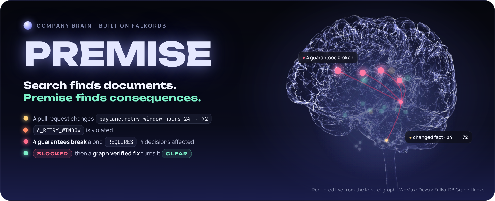</a>

<br><br>

[](https://github.com/Razeefshaik/Premise/actions/workflows/tests.yml)
[](https://razeefshaik.github.io/Premise/)


<p>
  <a href="https://premise-43eh.onrender.com/" title="Live app on FalkorDB Cloud"><b>🌐 Live app</b></a>
  &nbsp; · &nbsp;
  <a href="https://youtu.be/Ki3UHkeXfrE"><b>🎬 Watch demo</b></a>
  &nbsp; · &nbsp;
  <a href="https://razeefshaik.github.io/Premise/"><b>▶ Recorded replay</b></a>
</p>

<p>
  <a href="https://dev.to/razeef_shaik/search-finds-documents-my-graph-finds-consequences-434o">📝 Read the blog</a>
  &nbsp; · &nbsp;
  <a href="#the-real-github-flow">🔀 GitHub PR workflow</a>
</p>

<sub>The live replay is a <b>read-only recording</b> of real FalkorDB results, so anyone can explore it without installing anything.<br>
For the <b>full version</b> (live What if checks, Ask the company, PR assessments, verified fix PRs and the MCP server for coding agents),
<a href="#run-locally"><b>run it locally in two commands</b></a>.</sub>

</div>

---

## Contents

1. [The company brain](#the-company-brain)
2. [How it is built](#how-the-brain-is-built)
3. [Ask the company](#ask-the-company)
4. [When a change arrives](#when-a-change-arrives)
5. [A tour in screenshots](#a-tour-in-screenshots)
6. [The real GitHub flow](#the-real-github-flow)
7. [Graph data model](#graph-data-model)
8. [Cypher and graph algorithms](#cypher-and-graph-algorithms)
9. [Benchmark](#benchmark-what-does-structure-buy)
10. [Results and evidence](#results-and-evidence)
11. [Run locally](#run-locally)

---

## The company brain

**Premise is a company brain for engineering decisions: a connected memory of why your systems work, who understands them, and what could make them stop working.**

Engineering knowledge outlives the conversation that created it. The rationale sits in a decision record, the constraint in a config file, and the latest context in a ticket or chat. People move teams. Assumptions expire. The next engineer has to reconstruct the connections before making a change.

**Premise makes those connections explicit.** It brings decisions, promises, assumptions, people and evidence into FalkorDB, so a team can ask why something exists, find who knows about it, and check what a change would affect.

## How the brain is built

**Company knowledge becomes a model that people and coding agents can question, explore and check.**

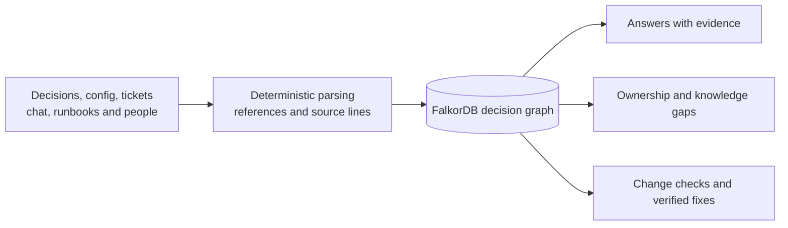

1. **Build the memory.** Deterministic parsers read supported decision records, config, tickets, chat, runbooks and company files. They retain source locations and validate the model before loading it.
2. **Connect the reasons.** Decisions make promises; promises depend on assumptions; assumptions depend on real values or dated human attestations. People, teams and source passages connect those dependencies to responsibility and evidence.
3. **Put the memory to work.** The same graph powers cited answers, an interactive Explorer, knowledge-gap analysis and change checks. Every Explorer result can expose its Cypher, parameters and timing.

**Keep it current:** an experimental evidence pipeline detects when new source claims disagree with the model, checks their quotes and independence, and proposes updates for human review. It stages evidence separately; only approved changes update the decision model. Slack/Jira intake currently uses fixtures, while GitHub supports read-only live intake. [Pipeline details](docs/V2.md).

**Why this approach matters:** a downstream decision can depend on a fact without mentioning it anywhere in its text. Explicit graph paths let Premise trace that relationship and explain it. FalkorDB powers those traversals, evidence lookup, assessment history, continuity algorithms and the vector-search benchmark. **Models may propose or explain; deterministic queries and code decide verdicts.**

## Ask the company

Ask why a decision exists, what it relies on, who should review it now, or what becomes
unverified when someone leaves. Answers use the same graph and cite its source files and lines.

The following walkthrough uses **Kestrel, our fictional demonstration company**, to show how those connections work.

For example, Anika Rao's [chat message](sandbox/kestrel-platform/chat/chat.jsonl) mentions
`ADR-012` and `G_DEDUPE`. Its passage links to both; the decision connects that conversation
to the payment service, the payments team and the promises behind charging once:

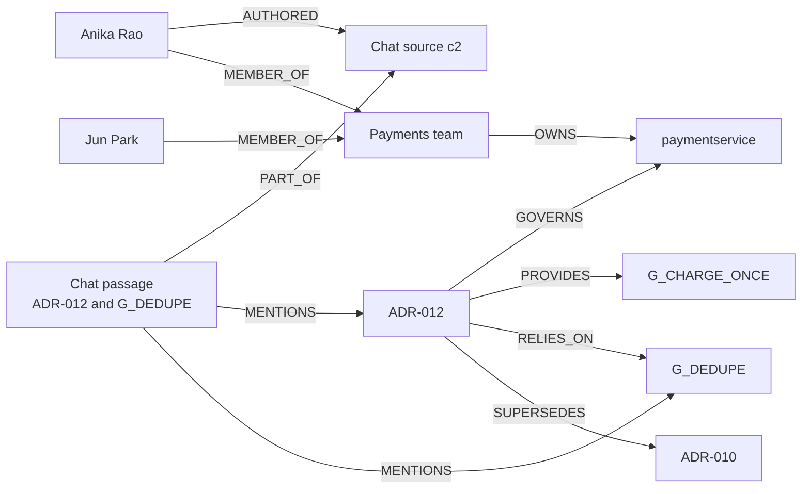

With the 180-day evidence window on 17 October 2026, current reviewer candidates are **Jun Park
(7 distinct recent authored sources)**, then **Anika Rao (2)**. The graph also flags an
**accountability gap**: ADR-012's author Marco Ruiz and approver Lena Fischer have both departed.
These roles and memberships come from the [decision](sandbox/kestrel-platform/adr/ADR-012.md)
and [people file](sandbox/kestrel-platform/company/people.yaml), rather than a model's guess.

The real local Ask endpoint returned HTTP 200 in deterministic mode for
"Why ADR-012, and who owns it now?" Its opening lines were:

> ADR-012: Payment service skips its own idempotency check. Lifecycle: accepted.
> Provides G_CHARGE_ONCE; relies on G_DEDUPE. Current reviewers: p_jun, p_anika.

The IDs in that exact response correspond to Jun Park and Anika Rao above. The response also
includes reviewer evidence counts, requirement paths and source citations.

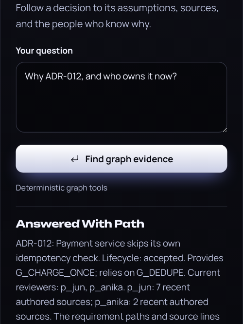

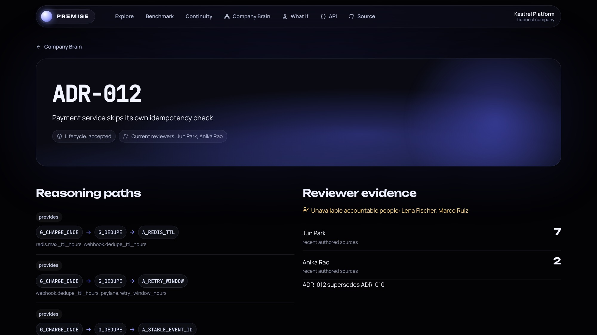

## When a change arrives

Because the brain knows what every promise rests on, it can tell what a change will break.

**Its blast radius, computed before merge.** A changed fact breaks an assumption, and the failure climbs `REQUIRES` (up to 6 hops) to every guarantee that depends on it. [`guarantee_impact.cypher`](premise/graph/queries/guarantee_impact.cypher) then returns the accepted decisions that provide or rely on each broken guarantee, the services they govern with their criticality tiers, and the services that call them through `DEPENDS_ON` (up to 3 hops). It is a blast radius for a *change*, caught at pull request time, not for an outage. An empty result is never treated as safety: the passing verdict is `CLEAR_WITHIN_SCOPE`, and an expired attestation makes a guarantee unknown, never healthy.

| 🔎 Trace | 🛑 Decide | 🩹 Heal |
| :-- | :-- | :-- |
| A changed fact flows up `REQUIRES` edges to every guarantee and decision that depends on it | The PR gets **BLOCKED**, **NEEDS_REVIEW** or **CLEAR**, with the broken chain and the right people to review | A fix PR opens **only after the graph proves** every affected guarantee holds again |

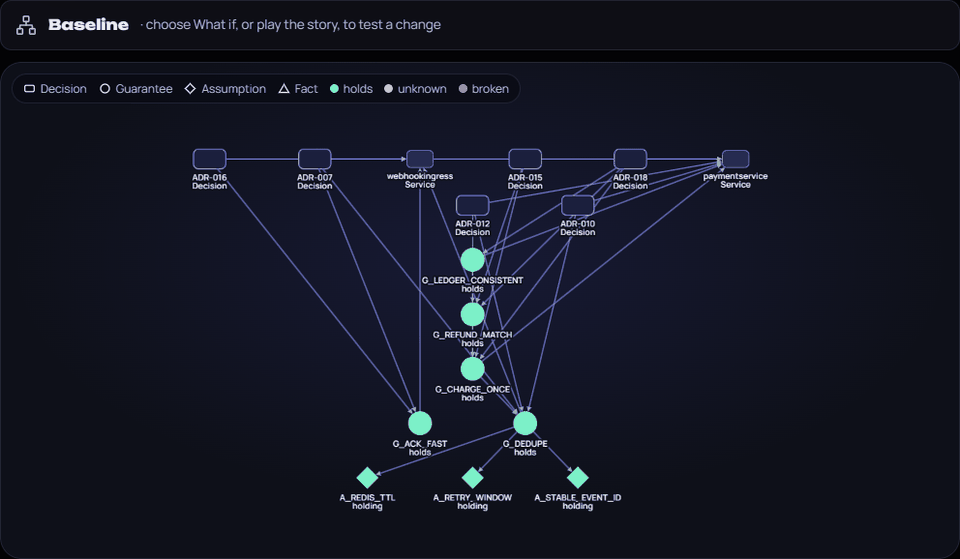

<sub>12 seconds from the Explorer, recorded against a real FalkorDB. [Record it again](scripts/record_propagation.py).</sub>

### The problem

A team decides "we deduplicate partner webhooks in Redis for 24 hours, because the partner
stops retrying after 24 hours". Three other decisions quietly build on that promise: charging
once, matching refunds, keeping the ledger consistent. Months later someone records that the
partner now retries for 72 hours. Every test passes. Nothing in those three decisions mentions
the partner, so search and code review never find them, and duplicate charges start.

Premise keeps the *reasons* behind decisions as a graph, so a change is checked against
everything that depends on it.

### What Premise does

1. **Answers company brain questions** from the same graph: what still holds, who knows about
   this, what breaks if this person leaves, which promises expire next month.
2. **Traces consequences.** A changed fact makes an assumption false, and the failure travels
   up `REQUIRES` edges to every guarantee and decision that depends on it, even when their text
   never mentions the changed value.
3. **Acts on the pull request.** Posts a `premise/decisions` commit status (BLOCKED, NEEDS_REVIEW
   or CLEAR_WITHIN_SCOPE) and one comment with the broken chain, the evidence lines, the
   decisions checked and not affected, and the people who should review.
4. **Fixes only what it has verified.** A bounded repair search tests candidate fixes on the graph
   and opens a fix PR only when the complete remedy turns every affected guarantee green.
5. **Stops coding agents before they edit.** An MCP server lets Claude Code or Codex ask
   Premise whether a change is safe before writing it.

### How it works

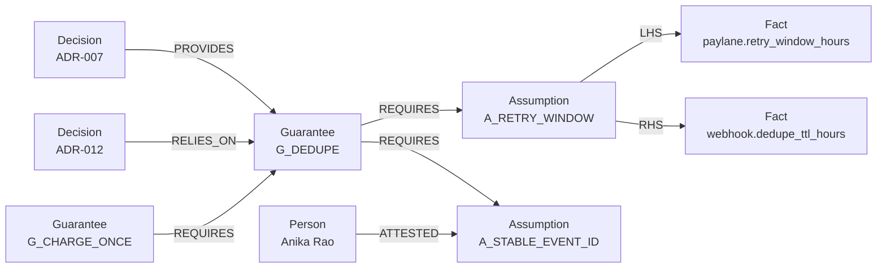

1. **Facts** are values in config files, ingested deterministically with their file and line.
2. **Assumptions** are predicates over two facts (`retry_window <= dedupe_ttl`) or a human
   attestation with a review date. An attestation only counts while it is current and the person is active.
3. **Guarantees** `REQUIRES` assumptions or other guarantees. `REQUIRES` is the only edge failure
   can travel along, so a broken assumption never leaks into unrelated decisions.
4. **Three valued logic.** A guarantee is *broken* if any prerequisite is violated, else *unknown*
   if any is unverifiable, else *holds*. Broken beats unknown beats holds. An expired attestation
   makes a guarantee unknown, never healthy.
5. **A pull request is an overlay.** Premise reads the changed values from the PR's own diff and
   evaluates them without mutating the main graph. The main graph changes only after merge.
6. **Every affected guarantee is judged on its full prerequisite closure**, not only the path
   the change touched, and sibling guarantees are evaluated before a decision is reported as unaffected.

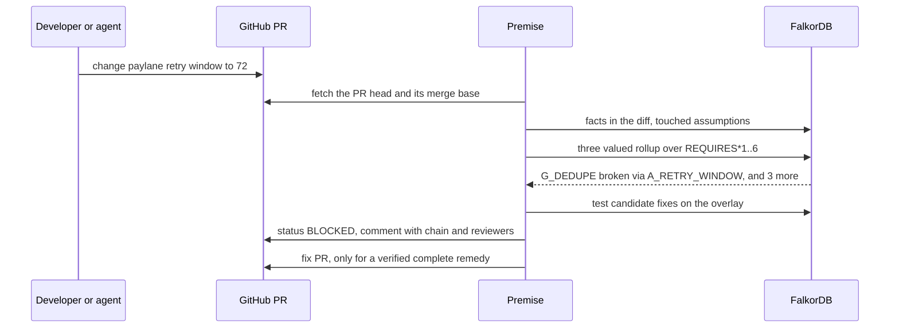

## A tour in screenshots

<details>
<summary><strong>Explore all eight product views: brain, failure, fix, Cypher, time machine and continuity</strong></summary>

**1. The company brain.** A fictional company, Kestrel: 12 tracked facts feed assumptions that
support 9 guarantees across its architecture decisions.

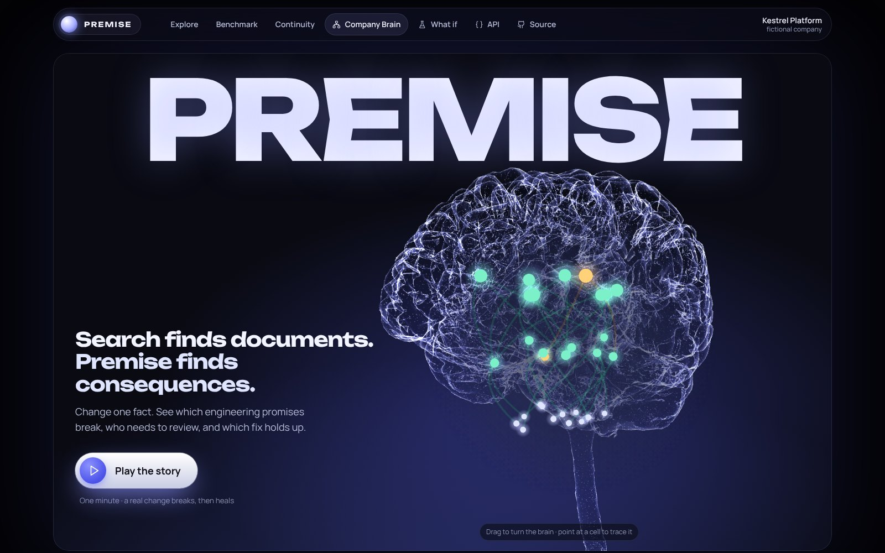

**2. Change one fact.** The partner retry window goes from 24 to 72 hours. `A_RETRY_WINDOW`
is violated and the failure travels up the `REQUIRES` chain.

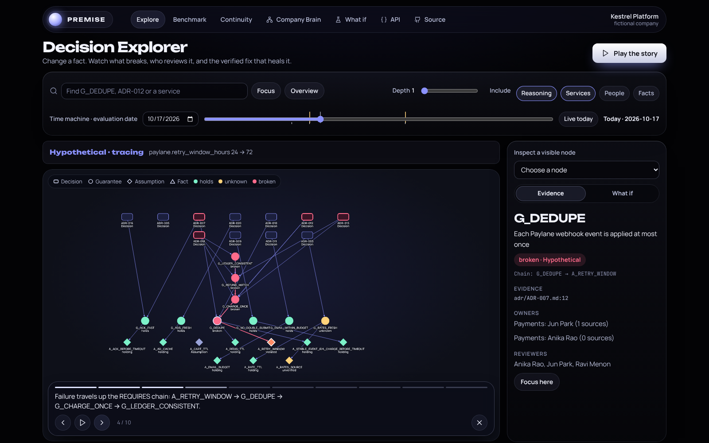

**3. The verdict.** BLOCKED: 4 guarantees broken, 4 decisions affected, review routed to
Anika Rao, Ravi Menon and Jun Park, people who are still at the company.

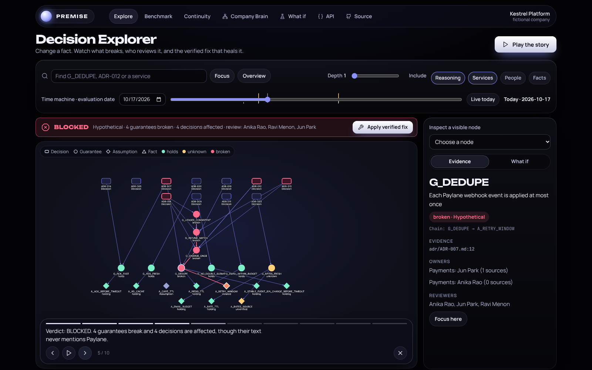

**4. The verified fix.** Raising the dedupe TTL alone would break the Redis maximum, so the
complete remedy raises both to 72 hours. Applying it turns every affected guarantee green.

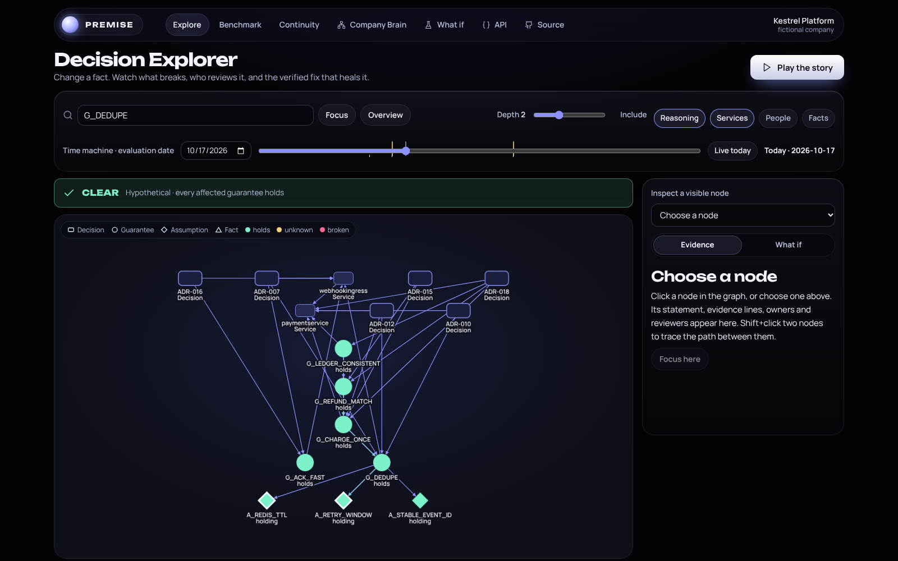

**5. Every verdict shows its Cypher.** The Explorer records each query it ran, with timings,
row counts and parameters. This is the query that decides guarantee health:

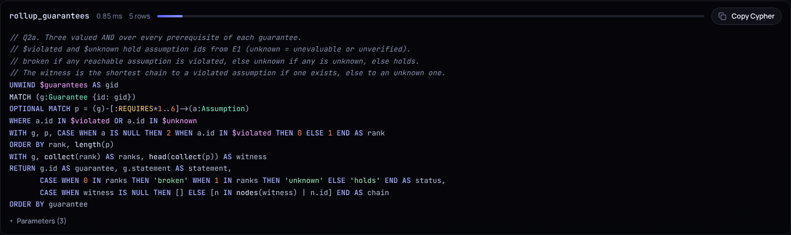

**6. Time machine.** Move the date to 2 March 2027. No code changes, but Anika's attestation
behind `A_STABLE_EVENT_ID` expires, so `G_DEDUPE` and four more guarantees become *unknown*.

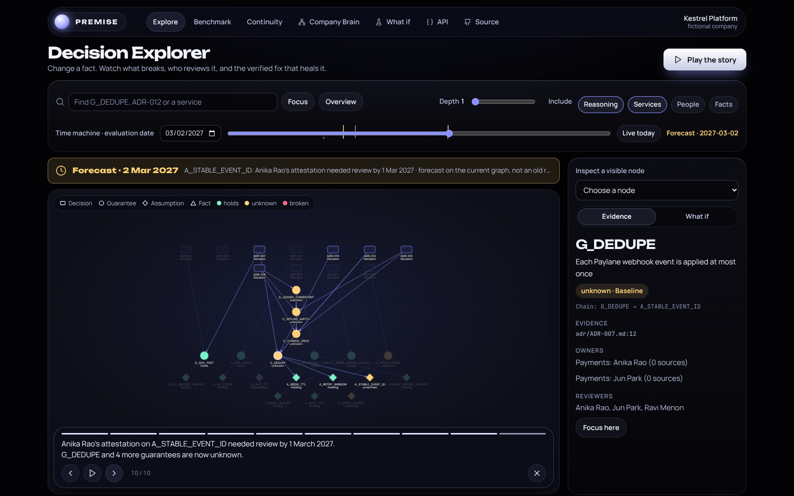

**7. When someone leaves.** A hypothetical departure shows accountability gaps, promises that
become unverified, the next reviewers, and FalkorDB betweenness for knowledge bridges.

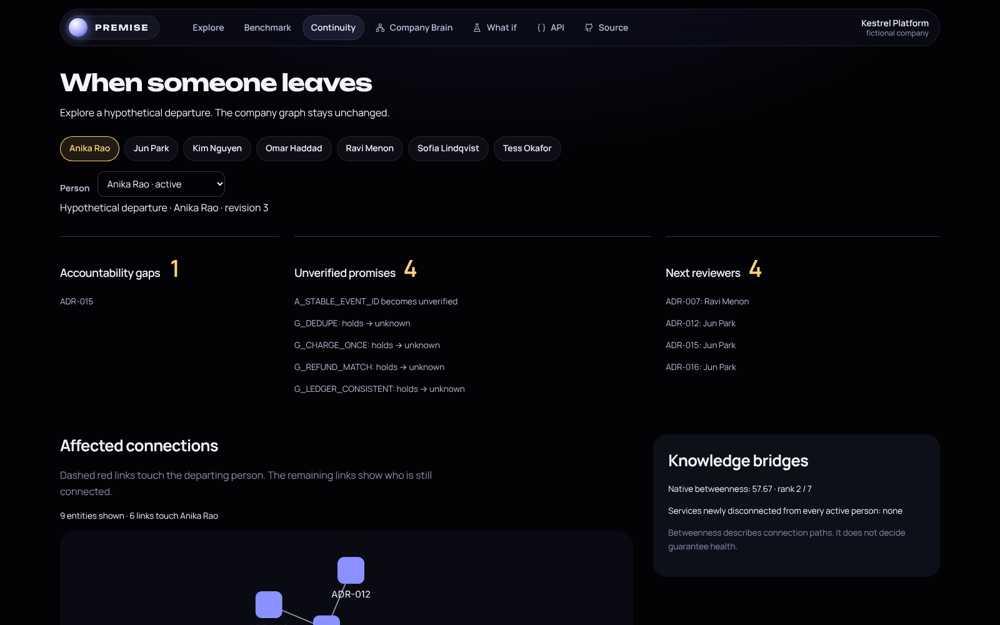

**8. The assessment record.** Every assessment is stored in FalkorDB with its reasons, the
changed facts and the shortest chain to each failure.

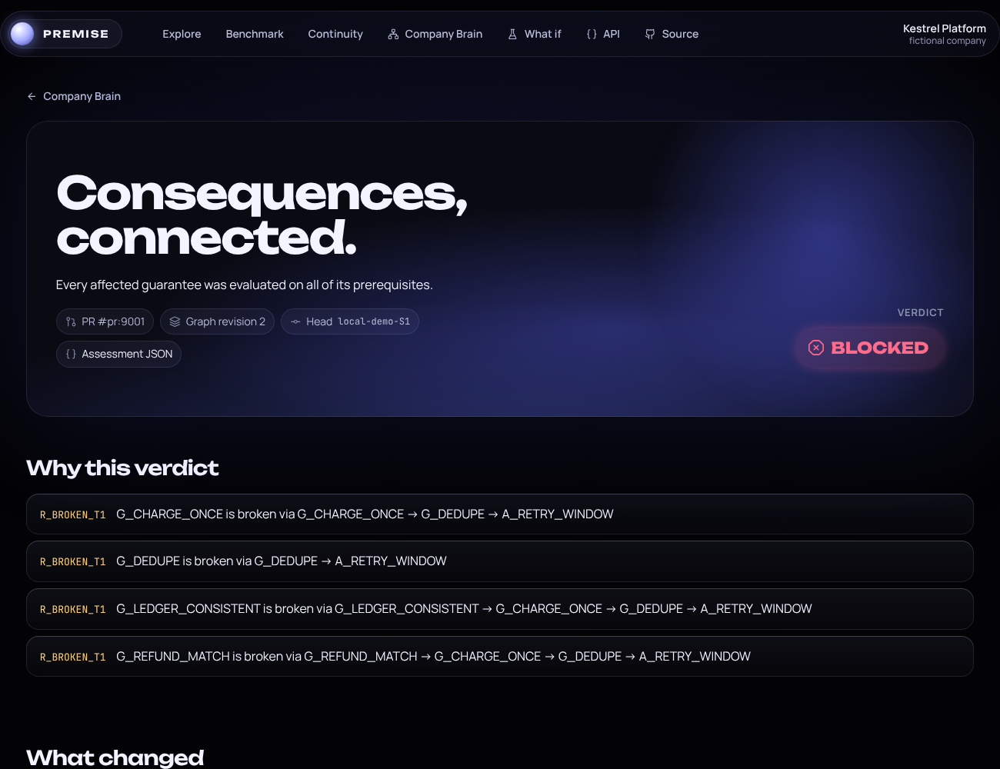

</details>

## The real GitHub flow

This ran on the fictional company's repository,
[Razeefshaik/kestrel-platform](https://github.com/Razeefshaik/kestrel-platform), on 16 October 2026 (times in IST):

| Time | Event | Evidence |
| --- | --- | --- |
| 12:25:59 | PR #1 "Record Paylane new 72 hour retry policy" is assessed: **failure**, `BLOCKED: G_CHARGE_ONCE is broken via G_CHARGE_ONCE -> G_DEDUPE -> A_RETRY_WINDOW` | [status on commit a2d6537](https://github.com/Razeefshaik/kestrel-platform/commit/a2d6537d62f8cd2e94d8a8e4ad4949329d25e4be) |
| 12:26:06 | Premise opens **fix PR #2** into PR #1's branch: `redis.max_ttl_hours = 72`, `webhook.dedupe_ttl_hours = 72`, "Graph-verified complete remedy" | [PR #2](https://github.com/Razeefshaik/kestrel-platform/pull/2) |
| 12:26:34 | The fix PR's own check: **success**, `CLEAR_WITHIN_SCOPE: 4 prerequisite assumptions checked` | [PR #2](https://github.com/Razeefshaik/kestrel-platform/pull/2) |
| 12:39:33 | A human merges the fix into PR #1's branch | [merge commit 7693573](https://github.com/Razeefshaik/kestrel-platform/commit/76935738b0279b1ee3f9985a10eaf7911cde961f) |
| 12:39:55 | PR #1 is re-assessed: **success**, every affected guarantee holds | [PR #1](https://github.com/Razeefshaik/kestrel-platform/pull/1) |

The PR comment is a single comment that Premise updates in place, so PR #1 now shows the
green version. The red result is kept in the commit status history linked above.
Screenshot 8 shows the same change assessed by the local demo. [PR #3](https://github.com/Razeefshaik/kestrel-platform/pull/3)
is a safe change (email retries within the provider budget) that passes.

Fixes and the original PRs are never merged automatically. Fork PRs never get fix branches.

## Graph data model

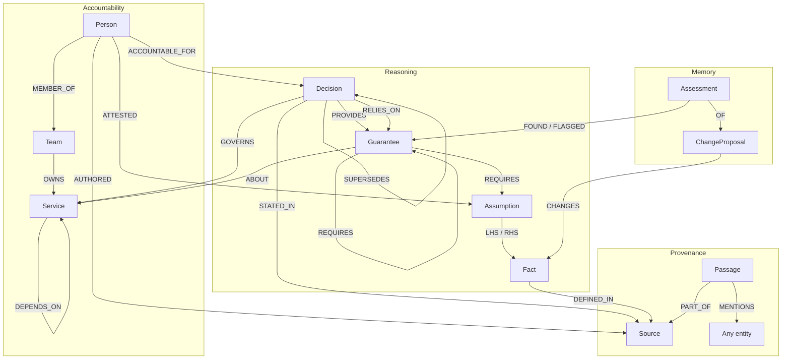

Every domain node has an `Entity` label and a fulltext-searchable description. Derived
health is computed on demand; only authored decision lifecycle is stored on domain nodes.
Historical assessments store their result snapshots for audit.

<details>
<summary><strong>Node types, relationship meanings and review routing</strong></summary>

| Nodes | Purpose |
| --- | --- |
| Decision, Guarantee, Assumption, Fact | Reasoning model and tracked configuration |
| Person, Team, Service | Accountability, ownership, expertise and service exposure |
| Source, Passage | Exact source commits, paths, lines, text and mentions |
| GraphState, ChangeProposal, Assessment, Action | Revisions, cursors, overlays, audit and execution memory |
| LLMCache | Request-hashed provider response replay; contains no API keys |

| Relationships | Meaning |
| --- | --- |
| PROVIDES, RELIES_ON | A decision promises or depends on a specific guarantee |
| REQUIRES | The only failure-propagation edge; AND semantics, acyclic, depth ≤6 |
| LHS, RHS, ATTESTED | Predicate operands and dated attestation by an active person |
| GOVERNS, ABOUT, DEPENDS_ON | Decision/service scope and caller exposure up to three hops |
| ACCOUNTABLE_FOR, MEMBER_OF, OWNS | Authored accountability and current ownership |
| STATED_IN, DEFINED_IN, PART_OF, AUTHORED, MENTIONS | Source provenance and deterministic text mentions |
| SUPERSEDES | Decision lifecycle linkage; superseded decisions never gate |
| CHANGES, OF, FOUND, FLAGGED, TOOK | Assessment and action history; never revision-swept |

Review routing prefers active authors and approvers. Otherwise active members of the current
owning team rank by distinct recent authored sources, then by ID.

</details>

## Cypher and graph algorithms

The verdict is a graph traversal. This is the query that decides guarantee health
([rollup_guarantees.cypher](premise/graph/queries/rollup_guarantees.cypher)):

```cypher
// Three valued AND over every prerequisite of each guarantee.
// broken if any reachable assumption is violated, else unknown if any is unknown, else holds.
// The witness is the shortest chain to a violated assumption if one exists, else to an unknown one.
UNWIND $guarantees AS gid
MATCH (g:Guarantee {id: gid})
OPTIONAL MATCH p = (g)-[:REQUIRES*1..6]->(a:Assumption)
WHERE a.id IN $violated OR a.id IN $unknown
WITH g, p, CASE WHEN a IS NULL THEN 2 WHEN a.id IN $violated THEN 0 ELSE 1 END AS rank
ORDER BY rank, length(p)
WITH g, collect(rank) AS ranks, head(collect(p)) AS witness
RETURN g.id AS guarantee, g.statement AS statement,
       CASE WHEN 0 IN ranks THEN 'broken' WHEN 1 IN ranks THEN 'unknown' ELSE 'holds' END AS status,
       CASE WHEN witness IS NULL THEN [] ELSE [n IN nodes(witness) | n.id] END AS chain
ORDER BY guarantee
```

Ranking each path (0 violated, 1 unknown, 2 fine) and sorting by rank then length gives both
the three valued result and the shortest witness chain in one query. That chain is what the
PR comment, the assessment page and the Explorer animation show.

All query arguments are parameters. Read tools use `GRAPH.RO_QUERY`; no user or LLM
input is executed as Cypher. Authored schema writes and operational memory writes are
fixed in the ingestor and store; their vocabulary cannot be selected by a model.

<details>
<summary><strong>Query-by-query responsibilities</strong></summary>

| Query | Responsibility |
| --- | --- |
| [graph_state](premise/graph/queries/graph_state.cypher) | Ready revision and main SHA |
| [facts_in_files](premise/graph/queries/facts_in_files.cypher) | Registered facts in the PR diff |
| [facts_by_id](premise/graph/queries/facts_by_id.cypher) | Fact values, control, paths and lines |
| [touched_assumptions](premise/graph/queries/touched_assumptions.cypher) | Inputs touched by the overlay |
| [guarantee_assumption_pairs](premise/graph/queries/guarantee_assumption_pairs.cypher) | Upward impact and complete downward prerequisites |
| [siblings](premise/graph/queries/siblings.cypher) | Related guarantees requiring independent evaluation |
| [evaluate_assumptions](premise/graph/queries/evaluate_assumptions.cypher) | Numeric/string predicates and current attestations |
| [rollup_guarantees](premise/graph/queries/rollup_guarantees.cypher) | Three-valued AND and shortest witness paths |
| [guarantee_impact](premise/graph/queries/guarantee_impact.cypher) | Accepted decisions, tiers, services and callers |
| [route_decision](premise/graph/queries/route_decision.cypher) | Review routing and evidence counts |
| [load_bearing_guarantees](premise/graph/queries/load_bearing_guarantees.cypher) | FalkorDB PageRank; display order only |
| [search_decision_passages](premise/graph/queries/search_decision_passages.cypher) | Lexical-gap baseline |
| [resolve](premise/graph/queries/resolve.cypher) | Fulltext entity resolution |
| [decision_lineage](premise/graph/queries/decision_lineage.cypher) | Requirements and facts supporting a decision |
| [who_knows](premise/graph/queries/who_knows.cypher) | Current service owners and evidence-ranked experts |
| [search_evidence](premise/graph/queries/search_evidence.cypher) | Source-grounded passage search |
| [evidence_sources](premise/graph/queries/evidence_sources.cypher) | Authored source citations |
| [orphaned_decisions](premise/graph/queries/orphaned_decisions.cypher) | Accountability gaps |
| [recall](premise/graph/queries/recall.cypher) | Historical assessments by entity |

**

</details>

FalkorDB features used, and where:**

| Feature | Used for | Where |
| --- | --- | --- |
| Variable length paths `[:REQUIRES*1..6]` | Failure propagation and witness chains | [rollup_guarantees](premise/graph/queries/rollup_guarantees.cypher) |
| `algo.pageRank('Guarantee', 'REQUIRES')` | Ordering "What still holds?" by how load bearing a guarantee is | [load_bearing_guarantees](premise/graph/queries/load_bearing_guarantees.cypher) |
| `algo.betweenness`, `algo.WCC` | Knowledge bridges and disconnection when a person leaves | [continuity.py](premise/web/continuity.py) |
| Fulltext index | Resolving names like "Paylane" or "ADR-012" to entities | [resolve](premise/graph/queries/resolve.cypher) |
| Vector index, `db.idx.vector.queryNodes` (cosine) | The vector RAG baseline in the benchmark, on the same database | [premise/benchmark](premise/benchmark) |
| `GRAPH.RO_QUERY` | Every read tool used by the MCP server, Analyst and web app | [premise/graph](premise/graph) |
| Redis Streams next to the graph | The v2 ingestion stream (XADD, consumer groups, XAUTOCLAIM) | [premise_v2/stream.py](premise_v2/stream.py) |

FalkorDB is the only datastore. It also holds graph revisions, PR cursors, assessments,
action history and the model replay cache, so the audit trail of every verdict lives in the graph.

## Benchmark: what does structure buy?

We compared graph reasoning, keyword search and vector RAG on FalkorDB, including questions about both **company knowledge** and **change impact**.

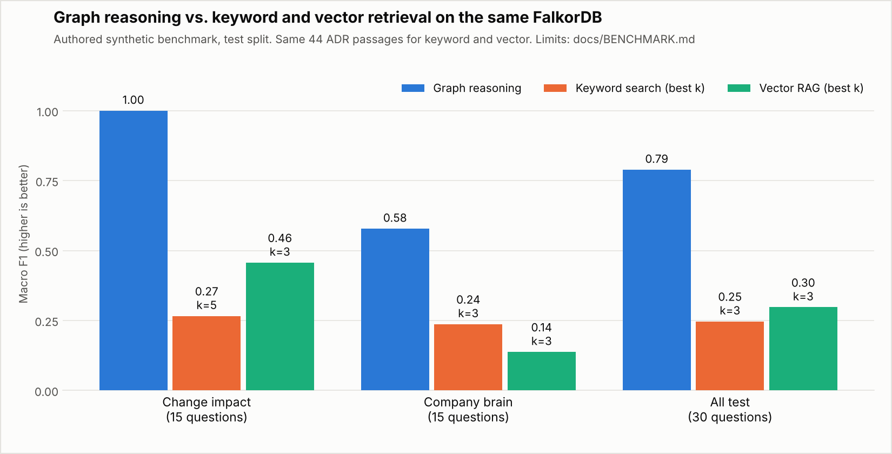

Across all 30 test questions, macro F1 is **0.79 graph · 0.30 vector · 0.25 keyword**. On the 15 company-brain questions, it is **0.58 · 0.14 · 0.24**; on the 15 change-impact questions, **1.00 · 0.46 · 0.27**. The chart shows the best tested retrieval setting for each subset.

**Scope:** authored synthetic questions and company data, with human label review pending. The graph has explicit dependencies; retrieval searches ADR passages. These results measure the benefit of that structure, not general intelligence. [Methods, every setting and raw results](docs/BENCHMARK.md).

## Results and evidence

| Recorded result | Evidence |
| --- | --- |
| **348 tests passed · 12/12 scenarios** | [Validation record](docs/VALIDATION.md) · [CI workflow](.github/workflows/tests.yml) |
| **35/35 red-team cases reached the expected safe outcome** | [Attacks and report](docs/REDTEAM.md); a regression suite, not security certification. |
| **Real statuses and a stacked fix PR** | [GitHub rehearsal](#the-real-github-flow); fixes require human merge. |
| **Inspectable reasoning** | [Cypher queries and graph algorithms](#cypher-and-graph-algorithms), source provenance and recorded assessments. |

## Run locally

From this checkout, with Docker Desktop's Linux engine running:

```bash
docker compose up --build -d
docker compose exec app premise demo
```

Open **[localhost:8000](http://localhost:8000)**. No API keys are needed for the local demo. Real GitHub actions require explicit setup and a sandbox token: [publishing guide](docs/PUBLISH.md).

The public live app is read only: GitHub actions, fix search, language models and v2 writes are disabled. Run locally for those features; see the [deployment guide](docs/DEPLOY.md).

**Stack:** Python · FastAPI · FalkorDB · Cypher · GitHub API · MCP

**Hackathon:** built by Shaik Mahammad Razeef for WeMakeDevs × FalkorDB Graph Hacks. **Track 3: Company Brain** and **Track 1: Agents That Act on Connected Data**.

**Current scope:** a single-company prototype using fictional data. The public site is a read-only replay; live questions and PR assessments run locally. [Full capabilities and limits](README_DETAILED.md).

**AI use:** Claude and OpenAI Codex assisted with implementation, review, tests, documentation and synthetic data. [Disclosure and attribution](README_DETAILED.md#ai-use-disclosure).

[Detailed README](README_DETAILED.md) · [Architecture](docs/DESIGN.md) · [Evidence pipeline](docs/V2.md) · [Replay](docs/REPLAY.md) · [Demo guide](docs/DEMO.md)
