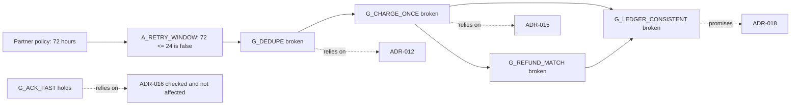
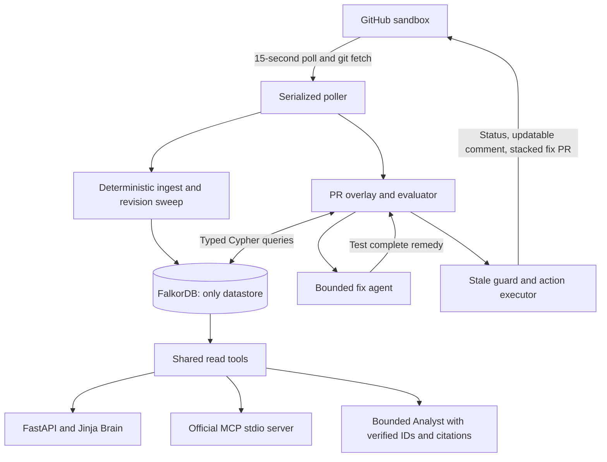

# Premise

**Every change checked against the guarantees your engineering decisions depend on.**

Premise connects architecture decisions to explicit guarantees, guarantees to their
prerequisites, and prerequisites to current facts and human attestations. A pull request
changes a fact; FalkorDB traces the consequences, routes review, and verifies remedies
before any fix PR can be opened.

Built for WeMakeDevs × FalkorDB Graph Hacks: **Track 1, Agents That Act on Connected Data**,
and **Track 3, Company Brain**. If only one track is allowed, use Track 1.
The authoritative design is [Revision 2](docs/Premise_Implementation_Spec.md).

[Product repository](https://github.com/Razeefshaik/Premise) ·
[Fictional company](https://github.com/Razeefshaik/kestrel-platform) ·
[Publishing handoff](docs/PUBLISH.md) · [Three-minute demo](docs/DEMO.md) ·
[Actual validation](docs/VALIDATION.md)

## The useful distinction

ADR-007 promises both deduplication and fast acknowledgement. ADR-012 depends on
deduplication; ADR-016 depends only on acknowledgement. When a partner extends its retry
policy, the first guarantee breaks while the second still holds. Premise reaches
ADR-012, ADR-015, and ADR-018 even though those decision bodies never mention the changed
partner policy. ADR-016 is explicitly evaluated and remains unaffected.



Changing TTL to 72 hours looks plausible, but breaks the Redis maximum of 48 hours.
The complete remedy raises both TTL and Redis max to 72. The fix controller accepts it
only after re-evaluating every prerequisite, including unchanged facts and current manual
attestations. An expired attestation leaves the guarantee **unknown**, never healthy.

## Run locally

Install Docker Desktop with a running Linux engine. No GitHub or model key is needed to
explore the company and local scenarios:

```bash
docker compose up --build -d
docker compose exec app premise demo
```

Open **http://localhost:8000** for the Brain and **http://localhost:3000** for the FalkorDB
Browser. The initial compose deployment defaults to local mode. The four saved demo rows
are labelled **Local demo**, use synthetic PR numbers, and make no GitHub calls.

```bash
docker compose exec app premise scenarios
docker compose exec app premise health
docker compose exec app premise ask "Why ADR-012, and who owns it now?"
docker compose exec app python -m pytest -q
docker compose logs --tail 50 app
```

The FalkorDB image is pinned to **v4.18.3**. Compose retains graph data in a named volume
with append-only persistence and exposes its ports on loopback. The app runs as a
non-root user on Python 3.12. Do not delete the volume to reset the demo; use
`premise reset --demo`, which only replaces local demo records.

For a host development environment:

```powershell
python -m venv .venv
# pip --python works even if ensurepip failed while creating the venv:
python -m pip --python .venv install -r requirements.lock
python -m pip --python .venv install --no-deps -e .
docker compose up -d falkordb
.\.venv\Scripts\python.exe -m premise.cli ingest
.\.venv\Scripts\python.exe -m premise.cli demo
.\.venv\Scripts\python.exe -m premise.cli serve
```

Linux/macOS use `.venv/bin/python` and the same CLI. Tests use a running server at
`FALKORDB_PORT`, otherwise port 6379. Linux can install `.[lite]` to use a real local
FalkorDB module instead; Windows requires the Docker server. Each test uses an isolated
graph and deletes it afterward.

## Real GitHub workflow

See [docs/PUBLISH.md](docs/PUBLISH.md) for the prepared local sandbox, manual push commands,
token permissions, explicit live rehearsal, branch protection, and the red-to-green demo.
The user requested local commits and will push manually. No live PR URLs or successful
remote actions are claimed before that rehearsal.

```bash
# After pushing the sandbox and configuring .env:
premise assess --pr 1 --json           # assess and save, no GitHub writes
premise assess --pr 1 --execute        # post real status/comment; fix only if enabled
premise poll-once                     # ingest current main, assess changed open PRs, execute
premise reconcile                    # reconcile actions interrupted during execution
premise serve                        # starts the poller only when enabled and token is present
```

The intake fetches `refs/pull/N/head`, checks the expected immutable SHA, and diffs the
PR's own merge base. Only files in that diff supply proposed values. Deleted keys stay
null; unrelated main-branch changes are never attributed to the PR. PR overlays do not
mutate the main graph's facts.

Execution posts `premise/decisions` commit statuses and one updatable issue comment with
paths, predicates, source lines, unaffected decisions, reviewers, and remedies. Every
action rechecks the PR SHA and graph revision. Graph-backed Action records and marker
search reconcile crashes; this is retryable execution, not an exactly-once claim.
The fix branch uses one atomic Git tree/commit for all edited files, preserving scalar
line edits and comments. Its PR base is the original PR branch. Fork PRs never receive
automatic fix branches. Fixes and the original scenario PRs are never merged automatically.

## Architecture and boundaries



FalkorDB holds domain data, graph revisions, PR cursors, assessments, action history and
LLM replay cache. Git checkouts and deployment configuration are files, not a second
application database. The replay cache lives in FalkorDB to honor locked decision D6;
this deliberately resolves the spec's later suggestion of a disk cache in favor of D6.
If the graph is unavailable or ingesting, assessment is ERROR, the commit status is
`error`, and no comment or fix PR is permitted.

The API poller performs one assessment at a time. Run **one app process and one executor**;
concurrent independent CLI executors are outside the supported deployment model.
Verdicts are deterministic Python policy over Cypher comparisons and graph traversals.
No model can pass/fail a check or authorize an action.

### Graph schema

Every domain node has an `Entity` label and a fulltext-searchable description. Derived
health is computed on demand; only authored decision lifecycle is stored on domain nodes.
Historical assessments store their result snapshots for audit.

| Nodes | Purpose |
| --- | --- |
| Decision, Guarantee, Assumption, Fact | Reasoning model and tracked configuration |
| Person, Team, Service | Accountability, ownership, expertise and service exposure |
| Source, Passage | Exact source commits, paths, lines, text and mentions |
| GraphState, ChangeProposal, Assessment, Action | Revisions, cursors, overlays, audit and execution memory |
| LLMCache | Request-hashed provider response replay; contains no API keys |

| Relationships | Meaning |
| --- | --- |
| PROVIDES, RELIES_ON | A decision promises or depends on a specific guarantee |
| REQUIRES | The only failure-propagation edge; AND semantics, acyclic, depth ≤6 |
| LHS, RHS, ATTESTED | Predicate operands and dated attestation by an active person |
| GOVERNS, ABOUT, DEPENDS_ON | Decision/service scope and caller exposure up to three hops |
| ACCOUNTABLE_FOR, MEMBER_OF, OWNS | Authored accountability and current ownership |
| STATED_IN, DEFINED_IN, PART_OF, AUTHORED, MENTIONS | Source provenance and deterministic text mentions |
| SUPERSEDES | Decision lifecycle linkage; superseded decisions never gate |
| CHANGES, OF, FOUND, FLAGGED, TOOK | Assessment and action history; never revision-swept |

Guarantee health is three-valued AND: broken dominates unknown, which dominates holds.
Every affected guarantee is checked on its full prerequisite closure; sibling guarantees
must actually be evaluated before a decision can appear under "checked and not affected."
Review routing prefers active authors/approvers. Otherwise active current owning-team
members rank by distinct recent authored sources, then by ID.

### Query reference

All query arguments are parameters. Read tools use `GRAPH.RO_QUERY`; no user or LLM
input is executed as Cypher. Authored schema writes and operational memory writes are
fixed in the ingestor and Store; their vocabulary cannot be selected by the model.

| Query | Responsibility |
| --- | --- |
| [graph_state](premise/graph/queries/graph_state.cypher) | Ready revision and main SHA |
| [facts_in_files](premise/graph/queries/facts_in_files.cypher) | Registered facts in the PR diff |
| [facts_by_id](premise/graph/queries/facts_by_id.cypher) | Fact values, control, paths and lines |
| [touched_assumptions](premise/graph/queries/touched_assumptions.cypher) | Inputs touched by the overlay |
| [guarantee_assumption_pairs](premise/graph/queries/guarantee_assumption_pairs.cypher) | Upward impact and complete downward prerequisites |
| [siblings](premise/graph/queries/siblings.cypher) | Related guarantees requiring independent evaluation |
| [evaluate_assumptions](premise/graph/queries/evaluate_assumptions.cypher) | Numeric/string predicates and current attestations |
| [rollup_guarantees](premise/graph/queries/rollup_guarantees.cypher) | Three-valued AND and shortest witness paths |
| [guarantee_impact](premise/graph/queries/guarantee_impact.cypher) | Accepted decisions, tiers, services and callers |
| [route_decision](premise/graph/queries/route_decision.cypher) | Review routing and evidence counts |
| [load_bearing_guarantees](premise/graph/queries/load_bearing_guarantees.cypher) | FalkorDB PageRank; display order only |
| [search_decision_passages](premise/graph/queries/search_decision_passages.cypher) | Lexical-gap baseline |
| [resolve](premise/graph/queries/resolve.cypher) | Fulltext entity resolution |
| [decision_lineage](premise/graph/queries/decision_lineage.cypher) | Requirements and facts supporting a decision |
| [who_knows](premise/graph/queries/who_knows.cypher) | Current service owners and evidence-ranked experts |
| [search_evidence](premise/graph/queries/search_evidence.cypher) | Source-grounded passage search |
| [evidence_sources](premise/graph/queries/evidence_sources.cypher) | Authored source citations |
| [orphaned_decisions](premise/graph/queries/orphaned_decisions.cypher) | Accountability gaps |
| [recall](premise/graph/queries/recall.cypher) | Historical assessments by entity |

### Agent and Company Brain

Deterministic repair always runs with a 16-evaluation budget. It keeps rejected candidates,
handles independent violation clusters, and verifies their combined remedy as a whole.
The optional Anthropic adapter permits at most eight fix-agent tool calls or six Analyst
tool calls. A model fix is accepted only when the identical changes map was tested in
that session; only finite numeric controllable facts are allowed, at most three per fix.
Partial repairs never become fix PRs. Provider errors/refusals preserve the fallback.

The adapter omits sampling parameters, forced tool choice, thinking overrides and assistant
prefill. It appends provider thinking blocks unchanged. `LLM_MODEL` defaults to the
specification's `claude-sonnet-5-5`; its live availability and API compatibility still
require an actual provider call with your key. No such successful call is claimed here.

Analyst outcomes distinguish sourced answers, assessment memory, unknown entities and
topics absent from the graph. IDs must exist in tool results; model-authored links are
rejected and citations come from server rows. The deterministic fallback shows the graph
evidence and its limitations. Source text is quoted untrusted data, never tool instructions.

The nine shared read tools are `resolve`, `decision_lineage`, `guarantee_health`,
`who_knows`, `search_evidence`, `orphaned_decisions`, `load_bearing_guarantees`,
`impact_if_broken`, and `recall`. Run `premise mcp` for stdio. See the
[MCP configuration and demo questions](docs/DEMO.md#mcp-setup).

## Environment variables

Copy `.env.example` to `.env` for local configuration; never commit tokens. Existing
environment values override `.env`. Credentials are excluded from settings repr, images,
remote URLs, graph records and application logs.

| Variable | Default / purpose |
| --- | --- |
| FALKORDB_HOST / FALKORDB_PORT | localhost / 6379; compose overrides host to falkordb |
| GRAPH_NAME | premise_kestrel |
| SANDBOX_DIR | sandbox/kestrel-platform, local fixture |
| SANDBOX_REPO | Razeefshaik/kestrel-platform |
| SANDBOX_CLONE_DIR | .runtime/kestrel, dedicated managed clone |
| GITHUB_TOKEN (or GH_TOKEN) | Sandbox-scoped token for actions |
| POLL_ENABLED | Compose defaults false; set true for real polling |
| POLL_SECONDS | 15 |
| AUTO_FIX_PR | false; explicitly enable verified fix PRs |
| PUBLIC_BASE_URL | http://localhost:8000; use a reachable deployment URL for judges |
| ANTHROPIC_API_KEY | Optional; no key means deterministic tools and repair |
| LLM_MODEL | claude-sonnet-5-5, configurable through the adapter |
| SINCE_DAYS | 180-day expertise evidence horizon |

## Tests and scenarios

Run `python -m pytest -q` and `premise scenarios` against a real FalkorDB server.
[docs/VALIDATION.md](docs/VALIDATION.md) records actual results and external work still
pending. GitHub tests use HTTP-level `httpx.MockTransport`, not fake graph reasoning.
The model is scripted in tests, and the MCP test opens a real official-SDK stdio session.

| Scenario | Expected / verified verdict |
| --- | --- |
| S1 partner retry 72 h | BLOCKED |
| S1_FIXED TTL and Redis max 72 h | CLEAR_WITHIN_SCOPE |
| S2 email attempts 8 | CLEAR_WITHIN_SCOPE |
| S3 deleted TTL | NEEDS_REVIEW |
| S4 invalid TTL type | NEEDS_REVIEW |
| S5 charge timeout 1500 ms | BLOCKED |
| S6 ad cache 600 seconds | NEEDS_REVIEW |
| S7 ADR model edit | NEEDS_REVIEW |
| S8 README-only change | CLEAR_WITHIN_SCOPE |
| S10 orphan cart assumption | NEEDS_REVIEW |
| S11 two independent violation clusters | BLOCKED; combined remedy independently verified |
| S12 expired currency attestation | NEEDS_REVIEW |

## Scope and limitations

This is a single-process, single-company prototype. Predicates support numeric ordering
and same-type string equality; there is no OR or weighted risk score. Changes to the
decision model get review and take effect only after merge. Polling replaces webhooks.
The local web interface has no authentication and binds to loopback through Compose;
public deployment needs an access-control boundary. Mermaid uses a pinned CDN version,
with readable graph text available if offline. Hosted status links require a public URL.

Live GitHub red-to-green testing, branch protection, provider calls, Claude Desktop UI,
recording/uploading the demo, and submission remain explicit external rehearsal steps.
The local reset command deliberately does not force-reset remote scenario branches.
The fictional dataset includes 20 tickets, 40 chat messages and four runbooks. The added
text preserves the flagship decision lexical gap and the original reviewer-evidence counts.

## Attribution and AI use

Kestrel, its people and partners are fictional. Its service naming and selected call edges
follow Google's [Online Boutique](https://github.com/GoogleCloudPlatform/microservices-demo),
licensed Apache-2.0, with fictional webhookingress and refundworker services added. No
Online Boutique implementation code is redistributed.

The supplied milestone, specification and original synthetic company text were produced with AI
assistance (Claude, as disclosed in the supplied README). This continuation used OpenAI
Codex for implementation, tests, documentation, six additional tickets, 34 chat messages
and two runbooks. Those examples were checked against the authored model and should be
reviewed by the project author before demonstration. Deterministic parsing builds the graph;
no LLM extracts production facts or decides verdicts. Synthetic data and automated test
evidence should be reviewed before the public demonstration.
