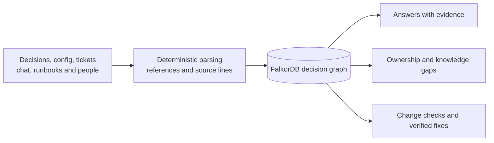

<div align="center">

<a href="https://razeefshaik.github.io/Premise/"></a>

<br><br>

[](https://github.com/Razeefshaik/Premise/actions/workflows/tests.yml)
[](https://razeefshaik.github.io/Premise/)


### [▶&nbsp; Try the live replay](https://razeefshaik.github.io/Premise/) &nbsp;·&nbsp; [🎬&nbsp; Watch the demo](https://razeefshaik.github.io/Premise/explore.html?story=1) &nbsp;·&nbsp; [🔴→🟢&nbsp; See a real PR go red, then green](#the-real-github-flow)

<sub>The live replay is a <b>read-only recording</b> of real FalkorDB results, so anyone can explore it without installing anything.<br>
For the <b>full version</b> (live What if checks, Ask the company, PR assessments, verified fix PRs and the MCP server for coding agents),
<a href="#run-locally"><b>run it locally in two commands</b></a>.</sub>

[The company brain](#the-company-brain) · [How it is built](#how-the-brain-is-built) · [Ask the company](#ask-the-company) · [When a change arrives](#when-a-change-arrives) · [Graph data model](README_DETAILED.md#graph-data-model) · [Cypher and algorithms](README_DETAILED.md#cypher-and-graph-algorithms) · [Benchmark](#benchmark-what-does-structure-buy) · [Run locally](#run-locally)

</div>

---

## The company brain

**Premise is a company brain for engineering decisions: a connected memory of why your systems work, who understands them, and what could make them stop working.**

Engineering knowledge outlives the conversation that created it. The rationale sits in a decision record, the constraint in a config file, and the latest context in a ticket or chat. People move teams. Assumptions expire. The next engineer has to reconstruct the connections before making a change.

**Premise makes those connections explicit.** It brings decisions, promises, assumptions, people and evidence into FalkorDB, so a team can ask why something exists, find who knows about it, and check what a change would affect.

## How the brain is built

**Company knowledge becomes a model that people and coding agents can question, explore and check.**



1. **Build the memory.** Deterministic parsers read supported decision records, config, tickets, chat, runbooks and company files. They retain source locations and validate the model before loading it.
2. **Connect the reasons.** Decisions make promises; promises depend on assumptions; assumptions depend on real values or dated human attestations. People, teams and source passages connect those dependencies to responsibility and evidence.
3. **Put the memory to work.** The same graph powers cited answers, an interactive Explorer, knowledge-gap analysis and change checks. Every Explorer result can expose its Cypher, parameters and timing.

**Keep it current:** an experimental evidence pipeline detects when new source claims disagree with the model, checks their quotes and independence, and proposes updates for human review. It stages evidence separately; only approved changes update the decision model. Slack/Jira intake currently uses fixtures, while GitHub supports read-only live intake. [Pipeline details](docs/V2.md).

**Why this approach matters:** a downstream decision can depend on a fact without mentioning it anywhere in its text. Explicit graph paths let Premise trace that relationship and explain it. FalkorDB powers those traversals, evidence lookup, assessment history, continuity algorithms and the vector-search benchmark. **Models may propose or explain; deterministic queries and code decide verdicts.**

## Ask the company

**Recover context, find the right people, and expose uncertainty before it becomes an incident.**

| What your team needs to know | What Premise gives you |
| --- | --- |
| **Why did we make this decision?** | Decision history, promised guarantees, assumptions and cited source passages. |
| **Who should review it now?** | Current people, accountability and recent authored evidence. |
| **What if this person leaves?** | Orphaned decisions, unverified promises and alternative reviewers. |
| **What becomes uncertain next month?** | Attestation expiry dates and the guarantees that depend on them. |
| **Can an agent safely make this edit?** | A hypothetical check of tracked facts and affected promises before it edits a file. |

The **Explorer** makes relationships navigable, **Continuity** simulates departures, and the **Time machine** evaluates future dates. Coding agents access the same knowledge through **11 read-only MCP tools**. [MCP setup](README_DETAILED.md#agents-and-mcp).

## See it in action: Kestrel

Kestrel is the fictional company we built to demonstrate Premise. Its **88 sources become 275 nodes and 488 relationships**, connecting 120 source passages to decisions, services, people and their dependencies.


*A real product view: click a node for its evidence or trace a path between two nodes.*

<details>
<summary><strong>See a decision's reasoning paths and reviewer evidence</strong></summary>


The decision page brings its dependencies and reviewer evidence together. Ask the company uses the same graph to provide cited answers in the local app.

</details>

### When a change arrives

Because the brain records dependencies, it can trace the consequences of a changed fact, even when a downstream decision never mentions that fact.

In this demo, a partner's retry window changes from 24 to 72 hours. Four guarantees fail. Raising deduplication alone would exceed the Redis limit, so Premise verifies a remedy that raises both limits.


**Trace the affected promises → report BLOCKED with reviewers → propose a verified fix → reassess after human merge.** Fixes are verified within the recorded model; Premise never merges them automatically. Missing or expired evidence produces uncertainty rather than a false assurance.

### The real GitHub flow

[Original PR #1](https://github.com/Razeefshaik/kestrel-platform/pull/1) → [verified fix PR #2](https://github.com/Razeefshaik/kestrel-platform/pull/2) → human merge → **CLEAR_WITHIN_SCOPE**. [Recorded status timeline](README_DETAILED.md#the-real-github-flow).

## Benchmark: what does structure buy?

We compared graph reasoning, keyword search and vector RAG on FalkorDB, including questions about both **company knowledge** and **change impact**.


Across all 30 test questions, macro F1 is **0.79 graph · 0.30 vector · 0.25 keyword**. On the 15 company-brain questions, it is **0.58 · 0.14 · 0.24**; on the 15 change-impact questions, **1.00 · 0.46 · 0.27**. The chart shows the best tested retrieval setting for each subset.

**Scope:** authored synthetic questions and company data, with human label review pending. The graph has explicit dependencies; retrieval searches ADR passages. These results measure the benefit of that structure, not general intelligence. [Methods, every setting and raw results](docs/BENCHMARK.md).

## Results and evidence

| Recorded result | Evidence |
| --- | --- |
| **348 tests passed · 12/12 scenarios** | [Validation record](docs/VALIDATION.md) · [CI workflow](.github/workflows/tests.yml) |
| **35/35 red-team cases reached the expected safe outcome** | [Attacks and report](docs/REDTEAM.md); a regression suite, not security certification. |
| **Real statuses and a stacked fix PR** | [GitHub rehearsal](README_DETAILED.md#the-real-github-flow); fixes require human merge. |
| **Inspectable reasoning** | [Cypher queries and graph algorithms](README_DETAILED.md#cypher-and-graph-algorithms), source provenance and recorded assessments. |

## Run locally

From this checkout, with Docker Desktop's Linux engine running:

```bash
docker compose up --build -d
docker compose exec app premise demo
```

Open **[localhost:8000](http://localhost:8000)**. No API keys are needed for the local demo. Real GitHub actions require explicit setup and a sandbox token: [publishing guide](docs/PUBLISH.md).

**Stack:** Python · FastAPI · FalkorDB · Cypher · GitHub API · MCP

**Hackathon:** built by Shaik Mahammad Razeef for WeMakeDevs × FalkorDB Graph Hacks. **Track 3: Company Brain** and **Track 1: Agents That Act on Connected Data**.

**Current scope:** a single-company prototype using fictional data. The public site is a read-only replay; live questions and PR assessments run locally. [Full capabilities and limits](README_DETAILED.md).

**AI use:** Claude and OpenAI Codex assisted with implementation, review, tests, documentation and synthetic data. [Disclosure and attribution](README_DETAILED.md#ai-use-disclosure).

[Detailed README](README_DETAILED.md) · [Architecture](docs/DESIGN.md) · [Evidence pipeline](docs/V2.md) · [Replay](docs/REPLAY.md) · [Demo guide](docs/DEMO.md)
