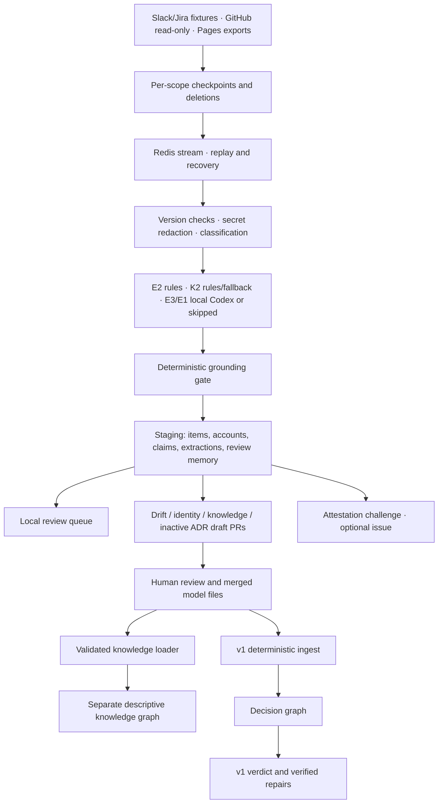

# Premise v2 (experimental): a company brain that keeps itself current

Phase 1 lives on `v2/self-maintaining-brain`; Phase 2 is isolated on `v2/phase-2`.
Nothing in staging or descriptive knowledge changes v1's verdicts.

## The idea

v1 checks pull requests against a model of decisions that people write by hand. v2 watches where the company
actually talks (Slack, Jira) and notices when reality may have changed, **before anyone opens a PR**.

> A Slack message says "Paylane now retries webhooks for 72 hours." v2 finds it, checks the quote, counts how
> many *independent* people said it, and opens a pull request that changes the value from 24 to 72. Premise v1
> then checks that PR like any other: BLOCKED, four guarantees break, and here is the verified fix.

## Three layers, one rule

```
 LAYER 3  Reasoning (Kind 1)   REQUIRES, PROVIDES, RELIES_ON      code constant, decides verdicts
 LAYER 2  Knowledge (Kind 2)   ON_CALL_FOR, VENDOR_FOR, ...       registry file, never decides verdicts
 LAYER 1  Evidence             Slack, Jira, ... in a staging graph   v2 works here
          ▲ things move up only through a pull request a human merges
```

v2 writes only to a Redis stream, its own **staging graph**, and its separate descriptive
**knowledge graph**. The decision graph is built by v1's deterministic
ingest from git and is only *read* by v2 (a test proves v2 issues zero writes to it after loading).

## The pipeline

```
fixture workers ─► Redis Stream ─► gateway ─► normalize ─► extract ─► GROUNDING GATE ─► staging graph
 (Slack, Jira)     (FalkorDB's      version check,  KIF rows,   fact claims   quote really in source,
                    own server)     redact secrets, identity    with status   value and fact inside quote
                                    rules, scope    links
                                                                      ─► reconcile ─► proposal PR ─► human
                                                                         independence,   validated by v1,
                                                                         line-level time, previewed by v1,
                                                                         rejection memory two exits
```

| Stage | File | What it does |
| --- | --- | --- |
| Envelope | `premise_v2/envelope.py` | CloudEvents style. Three identities: `event_id` (per emission), `entity_key` (the item, stable across edits), `content_hash` (no-op detection). `sequence` orders edits. Deletes are explicit tombstones |
| Workers | `premise_v2/workers.py` | Read Slack `conversations.history` and Jira `search` JSON shapes. The generator **returns its cursor last**; the runner saves it only after every envelope is in the stream. `list_keys()` lets the runner emit tombstones |
| Stream | `premise_v2/stream.py` | Consumer groups on the FalkorDB server. Re-reads its own pending entries, claims idle ones with `XAUTOCLAIM`, counts failures, dead letters after 3, acknowledges only after the result is committed |
| Gateway | `premise_v2/gateway.py` | Version check against the *latest* version (a revert to old text is not skipped), secret redaction before storage, rules classification, scope check |
| Normalize | `premise_v2/normalize.py` | KIF rows (same shapes as `chat.jsonl` and `tickets.jsonl`). Identity is **linked, never merged**: explicit mapping or exact email, otherwise `unresolved:` and never a reviewer |
| Extract | `premise_v2/extract/` | E2 numeric facts, E3 manual-assumption evidence, K2 descriptive relations, E1 decision drafts. Decimal values and mixed old/new units are converted deterministically |
| Grounding gate | `premise_v2/extract/` | Exact source quotes, registered references and source-backed fields are checked by code. Every model output goes through its extractor's gate |
| Staging | `premise_v2/staging.py` | Items, claims (with `CITES` edges carrying the quote and offsets), proposals, rejections, cursors |
| Reconcile | `premise_v2/reconcile.py` | Only asserted claims support a drift. Same person, same thread, or a cross link (a message quoting PAY-311) is **one origin**. `observed` needs 1 origin, `corroborated` 2+. `contested` when an independent origin denies it. Evidence older than the model's line (`git blame` of the exact YAML line) is ignored |
| Propose | `premise_v2/propose.py` | One proposal per (fact, value); reruns update, never duplicate. Validated with v1 `parse_repo` + `validate`; previewed with v1 `assess`. Body lists supporting, disagreeing and weak evidence, and two exits. A closed PR becomes rejection memory |
| Registry | `premise_v2/registry.py`, `ext/relations.yaml` | Kind 1 is the constant `REASONING_RELATIONS`; the registry must mirror it exactly and the pipeline refuses to run otherwise. Kind 2 entries need domain, range, examples; vague names are banned; retired entries keep a reason |

## What the research changed (before vs after)

| Before | After |
| --- | --- |
| One envelope id | Event id, entity key, content hash, sequence, tombstones |
| Cursor saved anytime | Cursor returned last, saved after the final `XADD` |
| Dedupe by hash | Compare with the latest version of that item |
| "Two sources" | Independent origins (person, thread, cross links) |
| File level timestamp | Exact line via `git blame` |
| No status | asserted, hedged, negated, instruction; only asserted supports drift |
| Quote check | Quote check plus "value, unit and fact are inside the quote" |
| New | Relation registry with the Kind 1 lock, rejection memory, two exit PRs |

## Run it

Phase 2 is developed separately on `v2/phase-2`. Connector checkpoints are JSON objects. A failed
item is recorded as a `ConnectorFailure` and does not stop other items; retryable failures retain
the checkpoint and suspend deletion checks for that connector until its snapshot is complete.
Slack and Jira retain their Phase 1 `fetch()` interface alongside the connector `load()` interface.
GitHub fixture exports go under `fixtures/v2/github/*.json`; markdown exports can be supplied with
`premise-v2 run --pages <folder>`. Front matter requires a timezone-aware `updated`, an `authors`
list and a `visibility` (`public` or `private`, default private). Read-only live GitHub intake is
explicit: `premise-v2 run --github-source owner/repo`. It does not enable PR publication.
The connector skips Premise-marked PRs and their comments, reads complete listings before making
tombstones, and normalizes CODEOWNERS into descriptive ownership rows rather than chat.

Phase 2 claims persist source accounts (`slack:U01ANIKA`), rather than a frozen person assignment.
Reconciliation reloads `ext/identities.yaml` and resolves only explicit or verified-email `auto`
links and reviewed `confirmed` links. Fuzzy display-name matches use RapidFuzz token-set ratio at
least 92 and create `proposed` links only. Removing a reviewed mapping leaves a reversible
`rejected` link; the account becomes unresolved again without reprocessing its messages.
Reviewed links are additional `links: [{account, person, status: confirmed}]` rows alongside the
existing `people` mappings. Regular proposals batch at most ten links; bridge or ambiguous
proposals get individual PRs and never influence counts before confirmation.

P2.3 adds `premise_v2/extract/` with E3 attestation evidence. Use
`premise-v2 run --llm-provider codex-cli --model-budget 40` for local Codex extraction, or
`--llm-provider none` for deterministic intake and drift checks with explicit skip counts.
The framework prefilters source items, requests source-first schemas, permits one schema repair,
caches by extractor/version/model/content hash, and grounds cached results again. Candidates and
rejections stay in staging. Two independent contradictions of a current attestation create a
review item and dry-run markdown. They never mutate the attestation or a verdict. Optional issue
publication requires both `--open-challenges` and `V2_OPEN_ISSUES=true`; private quotes are withheld.
Phase 1 numeric instruction mentions remain weak historical evidence for compatibility; the new
model-extraction path rejects instruction-bearing inputs before making model calls.

P2.4 extracts only approved Kind 2 types. Entity ids come from the decision graph and the explicit
v2 `ext/partners.yaml` registry; partner nodes are never inserted into the decision graph.
Known aliases use deterministic extraction, with a bounded model fallback for unmatched sentences
that mention two known entities. Quotes, endpoint mentions, type/domain/range and any literal dates
are checked in code. Unmatched verb phrases remain in staging for Phase 3; no new relation type is
proposed. Knowledge proposals add or end rows in `knowledge/relations.yaml`, preserving rotations.

After a human merges the knowledge file, run `premise-v2 load-knowledge --model <clone>`.
The CLI requires a clean tracked file on local `main` history, runs v1 ingest for that merged
model commit, validates every knowledge row before any knowledge write, and rebuilds the separate
`premise_knowledge` graph. Intervals are half-open (`valid_from` inclusive, `valid_to` exclusive),
must have positive duration and must not overlap for the same relation/endpoints. Unsupported
types, stale registry versions and wrong endpoint types are rejected. The knowledge graph name
must differ from both v2 graphs and every protected v1 graph. Verdict queries never read it.

Each connector owns a separate checkpoint and deletion scope: `slack:<channel_id>` for a Slack
channel, and `jira:<fixture_file_stem>` for a Jira fixture. Items and tombstones carry that scope.
A listing from one connector cannot delete another connector's evidence or advance its checkpoint.
Old unscoped items acquire their scope when their connector replays them.

Recovery pages through the consumer's pending entries and idle entries from other consumers,
then reads new entries. Each entry is attempted at most once per run. The summary reports
`stream.pending_after` and `caught_up`; when messages remain pending, proposals are skipped with
`proposal_skip_reason: "stream not caught up"` until a later run finishes recovery.

Proposals have four local lifecycle states: `open`, `withdrawn`, `merged`, and `rejected`.
The local document's `body_hash` is separate from `published_hash`, `pr_url`, `pr_number`, and
`remote_state`, which record what GitHub has confirmed. A dry run can therefore be published later
even if its document is unchanged; repeating the live run makes no writes when it is already current.

If supporting evidence disappears or drops to one independent origin, Premise marks the proposal
`withdrawn`. With GitHub enabled, it adds a **Withdrawn by Premise v2** banner and closes the PR.
Without GitHub, it records the local withdrawal and defers any remote closure until a live run.
An interrupted remote closure is retried without treating it as a human rejection. If corroborated
evidence returns, Premise can open a new PR. Human closure of an open proposal without merge is
`rejected` and retains the existing rejection-memory rule; a merged proposal is `merged`.

```bash
docker compose up -d falkordb          # or any FalkorDB 4.18+
pip install -e .
premise-v2 registry-check
premise-v2 run                         # dry run: writes .runtime/v2/proposals/*.md
premise-v2 eval --gold                 # offline recording replay; writes docs/V2_EVAL.md
premise-v2 eval --write .runtime/v2-fixture-eval.md  # original Phase 1 baseline
premise-v2 reset                       # deletes only the v2 staging graph and stream
```

Live pull requests are opt in and go to `SANDBOX_REPO` (kestrel-platform). Point `--model` at a fresh clone of that
repo's `main`, because the PR carries the local file with only the drifted value changed:

```bash
git clone https://github.com/<you>/kestrel-platform .runtime/kestrel-v2
V2_OPEN_PRS=true GITHUB_TOKEN=... premise-v2 --model .runtime/kestrel-v2 run --open-prs
```

The clone needs the `ext/` folder from this branch (copy `sandbox/kestrel-platform/ext/` into it and commit it there).

## Honest limits

* Slack and Jira still use fixtures. GitHub intake is read-only; Pages consumes local exports.
* Numeric facts need registered aliases/units. Identity proposals remain unresolved until a reviewed
  mapping is merged. Fuzzy similarity does not establish a person's identity.
* Local model extraction is optional, bounded and cached; with `none`, skipped work is reported.
  Exact grounding proves where words came from, not that the source or model interpretation is true.
* The evaluation is small, synthetic and awaiting Razeef's review. Scores are optimistic.
* Knowledge does not influence verdicts. New relation types, general incident diagnosis,
  organization-wide autonomous fixes and production authorization are outside this phase.
* Decision drafts require explicit human promotion of their inactive fields as well as acceptance/merge.

## Next: Phase 3

1. Live Slack/Jira access, deployment authorization and production identity evidence.
2. The relation manager: review unmatched clusters and propose registry changes.
3. Human-reviewed examples beyond the synthetic corpus, and broader real-world validation.

Research behind these decisions: see the report "Premise v2 knowledge pipeline design".
## Phase 2 architecture



Only the decision graph feeds verdicts. Account links are resolved during reconciliation;
only `auto`/`confirmed` count. Proposed bridges are reviewed individually at the strict 92 threshold.
Approved Kind 2 rows preserve temporal history in `knowledge/relations.yaml`, then
`load-knowledge` rebuilds the isolated knowledge graph from a clean merged model.

## Phase 2 gold evaluation

`python -m premise_v2.cli eval --gold` replays recorded local Codex responses through
`FakeAdapter`; it never calls a model or GitHub. The 80 source snippets and their 40/40 split
are protected by a SHA256 manifest. Source/prompt hashes reject stale recordings.
The corpus is synthetic, authored with Codex, and **awaits Razeef's hand review**.
Precision, recall, exact quotes, annotated-field accuracy, schema validity, rejection reasons,
calls and recorded inference seconds are reported separately. A perfect precision result
does not imply every annotated field or every real company message is correct.

To capture actual responses deliberately, outside tests:
`python scripts/record_v2_gold.py --split tune`, freeze the rules, then
`python scripts/record_v2_gold.py --split holdout`. Existing recordings are replayed, never
overwritten. Tune only against the tune half. Capture has a 40-call budget per split;
the resolved backend model is unknown when the CLI does not expose it.

## Local review page

Run `python -m premise_v2.cli serve` from this worktree, then open
`http://localhost:8002`. The server does not ingest, extract, publish, or edit files.
Collect evidence first with `run`. Fact changes (including single-origin watch items),
attestation challenges, identity/knowledge proposals and unmatched phrases are grouped
in the queue. Details show origin groups, source quotes, the recorded v1 preview, a diff
and the published proposal URL when available.

Dismiss is the only write action; it records a staging `Rejection`. It does not close
GitHub proposals. CSRF tokens and same-origin checks protect that action.
Private excerpts require a loopback bind, loopback client and localhost/loopback Host.
Forwarded headers are ignored. Remote requests hide private quotes, private phrase
clusters and private bodies/diffs. This local tool has no authentication.
Missing knowledge counts say "Unavailable" rather than pretending the graph is empty.

The v1 stylesheet is copied into the v2 package. Browser QA:
`python scripts/check_v2_ui.py` creates isolated real fixture graphs, checks desktop/mobile,
exercises Dismiss, saves local screenshots, and removes its graphs and stream afterward.

## Decision drafts and the v1 safety boundary

E1 reads explicit decision prose through the same local adapter, schema repair, shared call
budget and cache. Its gate checks all source quotes, known services, registered fact aliases,
literal values with unit conversion, operators and requirement indexes. A draft is validated
twice with v1's real parser and validator: once with prospective active fields (including its
cycle checks), then as the inert file offered for review.

**Implementation adjustment:** v1 currently parses guarantee/assumption fields even when
`status: proposed`. Therefore generated ADRs have empty active `provides`, `assumptions` and
`relies_on`; proposed content lives under `draft`. Ingesting the generated file adds no
guarantees, assumptions or reasoning dependencies and preserves the tested verdicts.
A human must promote reviewed draft fields, assign accountable people, set `accepted`,
validate, and merge. Changing status alone is insufficient. No v1 code was changed.

Private decision prose creates only a staging review item: no PR, model file or local dry-run
artifact. Exact quotes would otherwise leak through the ADR blob even with a redacted PR body.

